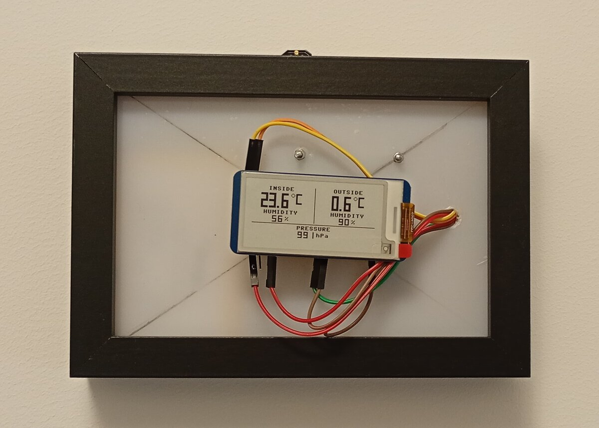
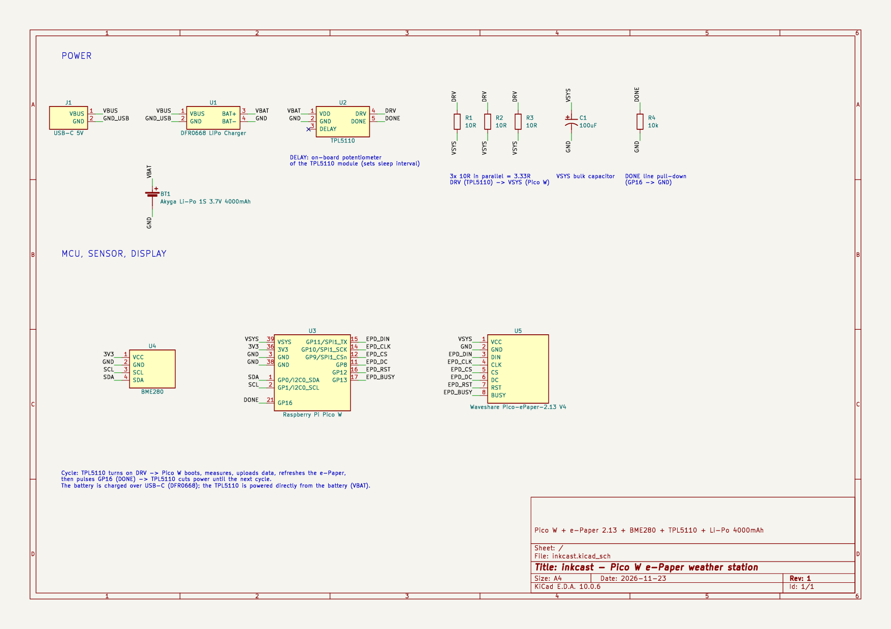

# inkcast

A battery-powered weather station built on a **Raspberry Pi Pico W** with a
2.13" **e-Paper** display. It shows indoor and outdoor temperature and humidity
plus atmospheric pressure, and logs everything to **ThingSpeak**.

The station draws almost no power between updates: a **TPL5110** timer cuts
power to the whole board, wakes it up periodically, and the Pico runs one
short measurement cycle before telling the timer to switch it off again.
The e-Paper keeps showing the last reading with no power at all.



Display layout:

```
 INSIDE        |   OUTSIDE
 24.6 °C       |   8.3 °C
 HUMIDITY      |   HUMIDITY
 58 %          |   94 %
---------------+---------------
        PRESSURE  967 hPa
```

## How it works

Every wake-up is a cold boot, so `main.py` runs exactly one cycle:

1. Read the indoor **BME280** sensor (temperature, humidity, pressure) over I2C.
2. Connect to WiFi and sync the clock over NTP (needed to sign Tuya requests).
3. Read the outdoor sensor (temperature, humidity, battery level) from the
   **Tuya Cloud API** – any Tuya/Smart Life temperature & humidity sensor works.
4. Upload all values to **ThingSpeak**.
5. Redraw the e-Paper display.
6. Pulse the TPL5110 **DONE** pin – the timer cuts power until the next cycle.

Every step is fault-tolerant: if a sensor, WiFi or a cloud service fails,
the remaining steps still run and missing values are shown as `--`.

## Hardware

| Part | Notes |
|---|---|
| Raspberry Pi Pico W | MicroPython firmware |
| Waveshare Pico-ePaper-2.13 (V4) | 250×122, plugs onto the Pico |
| BME280 module | I2C, address `0x76` (some modules use `0x77`) |
| TPL5110 power timer module | wake-up interval set by the on-board DELAY potentiometer |
| DFRobot DFR0668 | USB-C Li-Po charger |
| Akyga Li-Po 1S 3.7 V 4000 mAh | JST-BEC connector, 80×50×8 mm |
| 3× 10 Ω resistor | in parallel (≈3.3 Ω) between TPL5110 DRV and Pico VSYS |
| 100 µF electrolytic capacitor | bulk capacitor on VSYS |
| 10 kΩ resistor | pull-down on the DONE line |
| Tuya temperature & humidity sensor | outdoor readings via Tuya Cloud |

### Schematic



The KiCad 10 project is in [`hardware/`](hardware/): open
`hardware/inkcast.kicad_pro`. A PDF export is in
[`hardware/inkcast.pdf`](hardware/inkcast.pdf). The project-specific symbols
live in `hardware/inkcast.kicad_sym` and are registered by the project's own
`sym-lib-table`, so no extra libraries are needed.

### Wiring

Power path: **USB-C → DFR0668 → Li-Po battery (VBAT) → TPL5110 VDD →
TPL5110 DRV → 3× 10 Ω in parallel → Pico VSYS**. The battery feeds the
TPL5110 directly; the Pico and the display are powered only through the
TPL5110 output.

| From | To |
|---|---|
| Battery + / − | DFR0668 BAT+ / BAT−, TPL5110 VDD / GND |
| TPL5110 DRV (switched output) | 3× 10 Ω in parallel → VSYS (pin 39) |
| 100 µF capacitor | VSYS – GND |
| TPL5110 DONE | GP16 (pin 21), with 10 kΩ pull-down to GND |
| TPL5110 DELAY | on-board potentiometer (sets the sleep interval) |
| BME280 VCC | 3V3 (pin 36) |
| BME280 GND | GND |
| BME280 SDA | GP0 (pin 1) |
| BME280 SCL | GP1 (pin 2) |
| e-Paper DIN / CLK / CS | GP11 / GP10 / GP9 |
| e-Paper DC / RST / BUSY | GP8 / GP12 / GP13 |
| e-Paper VCC / GND | VSYS / GND |

## Software setup

1. Flash [MicroPython for Pico W](https://micropython.org/download/RPI_PICO_W/).
2. Create your config:
   ```sh
   cp config.example.py config.py
   ```
   and fill in WiFi credentials, the ThingSpeak Write API key and the Tuya
   credentials (see below).
3. Upload the files with [mpremote](https://docs.micropython.org/en/latest/reference/mpremote.html):
   ```sh
   pipx install mpremote
   mpremote fs cp main.py config.py bme280.py epd2in13.py : + reset
   ```

### ThingSpeak channel fields

| Field | Value |
|---|---|
| field1 | indoor temperature (°C) |
| field2 | indoor humidity (%) |
| field3 | pressure (hPa) |
| field4 | outdoor temperature (°C) |
| field5 | outdoor humidity (%) |
| field6 | outdoor sensor battery (%) |

### Tuya Cloud

1. Create a Cloud project at [iot.tuya.com](https://iot.tuya.com) and note its
   **Access ID** and **Access Secret**.
2. Link your Smart Life / Tuya app account to the project
   (*Devices → Link App Account*).
3. Copy the **Device ID** of your sensor from the device list.
4. Set `TUYA_BASE` to the data center of your project (e.g. Central Europe).

The script expects the data points `va_temperature` (in 0.1 °C),
`va_humidity` and `battery_percentage`, which is what most Tuya T&H
sensors report.

## Testing over USB

```sh
mpremote run main.py
```

Without the TPL5110 attached the program finishes the cycle and then keeps
pulsing the DONE pin forever – press `Ctrl+C` to stop it.

## Notes

- **Pressure** is the absolute (station) pressure, not adjusted to sea level,
  so it reads lower than weather forecasts at higher altitudes.
- The BME280 is used in **forced mode**: each read triggers one measurement
  and waits for it to finish. This is required with the TPL5110 – after a
  cold power-up the sensor's data registers hold reset values that decode to
  a constant, plausible-looking reading (about 21 °C) until the first
  conversion completes.

## Files

| File | Description |
|---|---|
| `main.py` | the measurement cycle and display layout |
| `bme280.py` | minimal BME280 driver |
| `epd2in13.py` | Waveshare e-Paper 2.13" V4 driver ([source](https://github.com/waveshareteam/Pico_ePaper_Code), MIT-style license) |
| `config.example.py` | configuration template |
| `hardware/` | KiCad 10 schematic (`inkcast.kicad_pro`), PDF and PNG export |

## Credits

- e-Paper driver: [Waveshare Pico_ePaper_Code](https://github.com/waveshareteam/Pico_ePaper_Code)
- BME280 compensation formulas: Bosch BME280 datasheet

## License

[MIT](LICENSE). The bundled `epd2in13.py` driver is © Waveshare and keeps its
own license notice in the file header.
